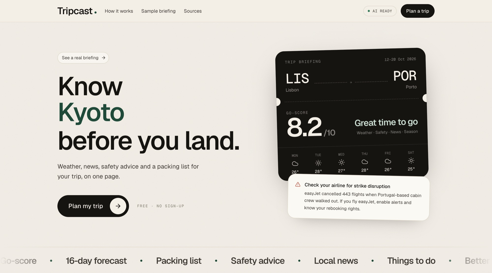
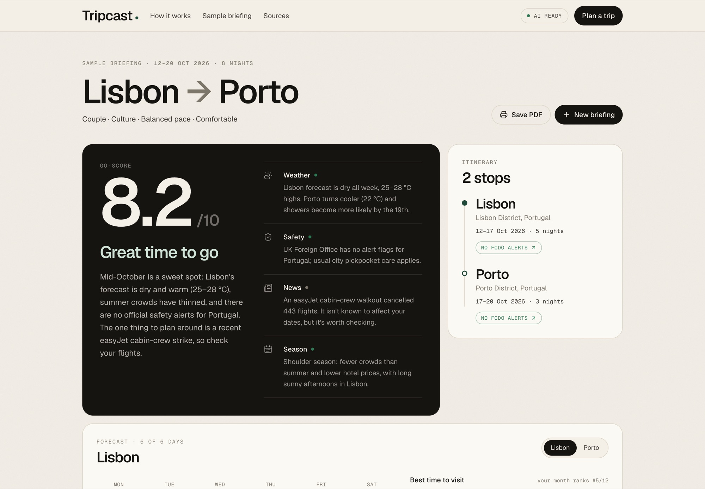
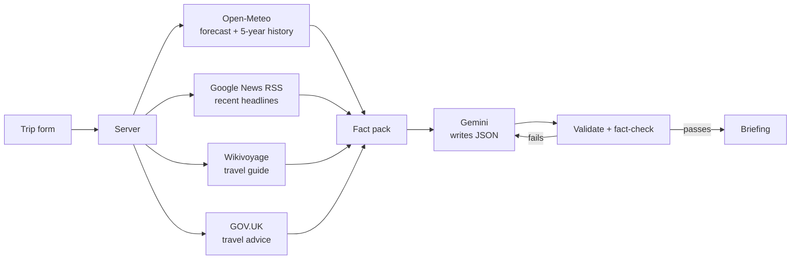

<div align="center">

# Tripcast

**Know the place before you land.**

A pre-trip briefing for any itinerary. Live weather, local news, safety advice and travel tips,<br/>
pulled from real sources and written up by Google Gemini on a single page.

<br/>


<br/>



</div>

<br/>

## Why I built it

I travelled a lot this year, and before every trip I ended up with the same twenty tabs open: the
forecast, the news, the Foreign Office page, a travel guide, a packing list in my notes app. None
of them knew anything about *my* trip.

I wanted one page that did, built on facts I could trust instead of a chatbot guessing. So I built
Tripcast. You tell it where you're going, when, and who with. It goes and gets the facts, then
writes you a briefing.

## What you get

<table>
<tr>
<td width="50%" valign="top">

**Go-score.** A 1 to 10 verdict on the trip, broken down into weather, safety, news and season.

**Weather.** A day-by-day forecast for trips within 16 days, and five years of history for
anything further out, including the best months to go.

**Heads-up.** Strikes, closures and safety notes worth knowing before you leave.

</td>
<td width="50%" valign="top">

**Things to do.** Matched to your interests and pace, timed for the dry days.

**Packing list.** Every item comes with a reason, and you can tick things off as you pack.

**News and alternatives.** What's happening there, with links to the articles, plus better
dates and similar places if now isn't ideal.

</td>
</tr>
</table>

<div align="center">

</div>

## How it works

The rule behind the whole app: **the code fetches the facts, and the model only writes.**
Gemini is never asked to look anything up. Every number, headline and link on the page comes
from one of the sources below.



Each briefing makes calls to six services: Open-Meteo for place search and weather, Google News,
Wikivoyage, the GOV.UK Content API and the Gemini API. The four data sources run in parallel for
every stop, and any one of them can fail without breaking the briefing.

## The language side

Most of the interesting work is in getting a small, free language model to be useful and accurate.

| Technique | Where it shows up |
|---|---|
| **Grounded generation** | The model receives a compact "fact pack" assembled from the APIs and is told to write only from it. This is retrieval-augmented generation without a vector store: the retrieval is done by structured API calls. |
| **Constrained prompting** | An explicit allow/deny list (no business names, prices, dates or numbers that aren't in the facts), a fixed JSON shape, and a low temperature of 0.2. |
| **Structured output** | Gemini replies in JSON mode. A tolerant parser recovers JSON from messy replies, and a Zod schema validates every field, trimming or dropping bad items instead of failing. |
| **Citation by reference** | Headlines are tagged `N1`, `N2`… and the model cites those IDs. Links are attached by the code, so the model can't invent a URL. |
| **Hallucination check** | Every temperature and percentage the model writes is matched against the fact pack. Unsupported numbers trigger a corrective retry. |
| **Text extraction** | HTML from Wikivoyage and GOV.UK is cleaned, split into sections and trimmed to fit the context window. News is filtered by keyword to drop sport and noise. |

## Tech stack

| | |
|---|---|
| **Framework** | Next.js 16 (App Router, route handlers, streaming responses) |
| **UI** | React 19, Tailwind CSS 4, Geist fonts, Lucide icons |
| **Language** | TypeScript, with Zod 4 for validation |
| **AI** | Google Gemini API, free tier (Flash and Flash-Lite models) |
| **Data** | Open-Meteo, Google News RSS, Wikivoyage, GOV.UK Content API |
| **Testing** | Vitest (offline unit tests and live source tests) |
| **Hosting** | Vercel |

No database and no accounts. Briefings and packing ticks are saved in the browser.

## Run it locally

You need [Node.js](https://nodejs.org) 20.9 or newer and a free Gemini API key from
[Google AI Studio](https://aistudio.google.com/apikey).

```bash
npm install
cp .env.example .env.local     # then paste your key into GEMINI_API_KEY
npm run dev                    # open http://localhost:3000
```

On a Mac you can also double-click `start-mac.command`, or `start-windows.bat` on Windows.
They install everything on the first run and open the browser.

## Deploy to Vercel

1. Push this folder to a GitHub repository.
2. On [vercel.com](https://vercel.com/new), import the repository. The defaults are correct.
3. Under **Environment Variables**, add `GEMINI_API_KEY` with your key.
4. Deploy.

## Scripts

| Command | What it does |
|---|---|
| `npm run dev` | Start the app on localhost:3000 |
| `npm run build` | Production build |
| `npm run check` | Type-check, lint and unit tests (offline) |
| `npm run check:live` | Test every data source against the real APIs |

## Project layout

```
src/
├── app/            pages and API routes (/api/briefing, /api/places, /api/quota)
├── components/     home page, trip form and briefing dashboard
└── lib/
    ├── sources/    weather, news, guide, travel advice, place search
    ├── ai/         Gemini client, prompt, JSON parser, fact-checker
    └── briefing.ts gathers the facts, calls the model, checks the answer
tests/
├── unit/           offline tests
└── live/           real API tests
```

## Good to know

- Gemini's free tier has per-minute and per-day limits. A briefing uses one request, two at most,
  and identical trips are cached for six hours.
- Forecasts only reach 16 days ahead. Further out, Tripcast uses typical weather for your dates.
- Open-Meteo and the other free sources are meant for non-commercial use.
- Safety information comes from the UK Foreign Office. Always check your own government's advice too.

<br/>

<div align="center">
<sub>Built by Siddharth, for the trips ahead.</sub>
</div>
